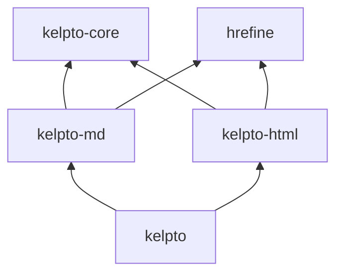

# Design sketch: each library alone, and together

A first sketch (2026-10-30). Nothing here is decided; it's meant to
make the choices visible. See [plan.md](plan.md) for goals and tests.

## Libraries and layout

One repo, one Temper worktree, libraries in subdirectories, versioned
together:

| Directory | Package | What it is |
|---|---|---|
| `kelpto-core/` | `kelpto-core` | Spans, the lossless tree's shared interfaces, and HTML's character references. Small, with no dependencies. |
| `kelpto-md/` | `kelpto-md` | CommonMark, lossless: parse, edit, print, and render. |
| `kelpto-html/` | `kelpto-html` | The WHATWG HTML parser, lossless, plus a sanitizer. |
| `kelpto/` | `kelpto` | Both together: HTML inside Markdown understood as HTML, and safe rendering of Markdown in one call. |

Dependencies go one way, so there's no cycle:

Why four rather than two: Markdown alone shouldn't carry an HTML
parser (most of the size), and HTML alone shouldn't carry a Markdown
parser, yet both need spans, the same tree interfaces, and the
character references (about 2,200 entries). `kelpto-core` is that
shared part, and most users never name it. The umbrella package takes
the plain name, `kelpto`, so "install kelpto" gets everything.

## Shared ideas (kelpto-core)

- **Spans:** `Span(start, length)` in code points of the input, as in
  Hrefine's `SourceSpan`, ideally the same type shared across both
  libraries.
- **Lossless nodes:** every node can print exactly the text it was
  parsed from (`asWritten`), trivia included, and knows its span.
  Printing an unchanged tree gives back the input byte for byte.
- **Immutable trees, edits by replacement:** `doc.replace(node, new)`
  gives a new document whose text changes only inside `node`'s span;
  nodes are values, safe to share across threads, as Hrefine's `Url`
  is. Building a node from scratch gives it canonical text.
- **Two outputs, never confused:** `asWritten` (the source, exactly)
  and a normalized form (`format()`), each named for what it is.
- **Character references:** the table and decoding, used by both
  parsers.

## kelpto-md alone

What someone with only Markdown wants: edit Markdown files without
churning them, and render Markdown to HTML.

- **Parse and print:** `parseMarkdown(text)` gives a `MarkdownDocument`;
  `doc.asWritten` is the input again.
- **Typed tree:** node types by where they can go, after Mike's idea:
  sealed interfaces such as `BlockNode`, `InlineNode`, and
  `LinkTextNode` (links can't nest), so built trees are valid by
  construction.
- **Edits:** replace, insert, and remove nodes; a heading's text, a
  link's target, a code block's info string. Only the touched span is
  rewritten.
- **Building:** constructors and builders that read well in each
  language, plus the context Mike described for anchors and link
  definitions that never collide.
- **Rendering to HTML:** CommonMark's HTML output, with secure defaults:
  - **Raw HTML is escaped by default,** shown as text. Passing it
    through needs an explicit, plainly named choice, such as
    `withRawHtmlTrusted()`, and the docs say what that risks.
  - **Link and image targets are checked** with Hrefine: a scheme
    allowlist (http, https, mailto, relative) by default, so
    `javascript:` and tricky spellings never become live links.
- **Raw HTML in the tree:** kept as an opaque node with its text, found
  by CommonMark's own rules, through an interface (`RawHtmlHandler`)
  that `kelpto` fills in with a real parser.

## kelpto-html alone

What someone with only HTML wants: parse HTML as browsers do, edit it
without churning it, and sanitize untrusted HTML.

- **Parse:** `parseHtmlDocument(text)` and `parseHtmlFragment(text,
  context)`, following the standard's tokenizer and tree construction,
  so the tree is what a browser builds, misnesting and all.
- **Two views of one parse:**
  - **As written:** tokens with spans, so a tool can change one
    attribute and leave the rest byte for byte.
  - **As built:** the element tree the standard constructs, which can
    differ from the source's nesting (implied `<tbody>`, adopted
    formatting elements). Each built node points back at the spans it
    came from, where it has one.
- **Serialize:** the standard's fragment serializer (normalized), and
  lossless printing of the as-written tokens.
- **Sanitize:** a sanitizer working on the built tree, the only safe
  place to judge HTML: an allowlist of elements and attributes,
  Hrefine checking every URL-valued attribute, and safe defaults
  (no scripts, event handlers, `style` unless asked, or `srcdoc`).
  Its output is `SafeHtml`: HTML the library understands and has
  checked, as structure, not just a string.

## Together (kelpto)

What the pair adds that neither can alone:

- **HTML inside Markdown, understood:** `kelpto` fills in kelpto-md's
  `RawHtmlHandler` with kelpto-html, so raw HTML blocks and inline tags
  become HTML subtrees in the Markdown tree, still lossless.
- **Safe rendering in one call:** `renderSafe(doc, policy)` renders
  Markdown, parses any raw HTML, sanitizes the result as one tree, and
  returns `SafeHtml`. That's the common case for comments, READMEs, and
  chat: Markdown from users, HTML for a page.
- **Typed embedding:** an HTML fragment built with kelpto-html's
  builders (or `SafeHtml`) placed in a Markdown document, printed as
  raw HTML Markdown keeps.
- **Maybe later:** HTML to Markdown.

## Secure defaults, everywhere

- Escape what isn't understood; sanitize what is.
- Never decide on text as written; check the parsed, normalized form,
  as Hrefine does.
- Name the dangerous choices plainly (`Trusted`, `WithCredentials`),
  never with "safe" or "secure".
- Never log or echo raw input in errors.

## Open questions

- Is a separate `kelpto-core` worth it, or should kelpto-md own the
  shared parts and kelpto-html depend on kelpto-md? (Simpler, but HTML
  users would carry a Markdown parser.)
- Should kelpto-md depend on Hrefine for link checks, or take a link
  policy through an interface with a simpler default? Hrefine is the
  safe choice, at the cost of its size (its IDNA tables).
- The umbrella library's directory: `kelpto/` inside the `kelpto` repo
  reads oddly; a different directory name with the package still named
  `kelpto` is possible.
- Mutable builders plus immutable documents, or immutable all the way?
- Can Hrefine's `SourceSpan` and kelpto-core's span be one type (a tiny
  shared library), or should each keep its own?
