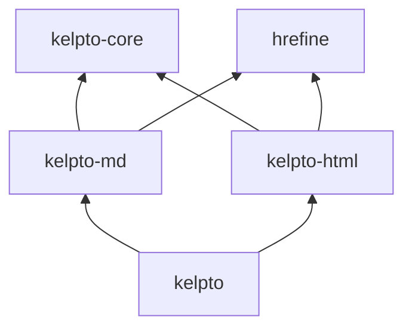

# Design sketch: each library alone, and together

A first sketch (2026-10-30). Nothing here is decided unless it says
so; it's meant to make the choices visible. See [plan.md](plan.md) for
goals and tests.

## Decided so far (the user, 2026-10-30)

- **Four libraries,** with a separate `kelpto-core`.
- **URLs are a wrapper on `String` for now** (say `LinkTarget`), with
  no URL processing yet; revisit later. If Hrefine comes in, it comes
  as a git submodule, and some of its Unicode processing might be
  extracted for shared use.
- **Order:** settle how kelpto-md and kelpto-html coordinate, then
  build the Markdown side only.
- **Red-green trees from the start,** as in "Edits without heavy
  copying", below, since retrofitting positions is hard.

## The skeleton (2026-10-30)

A first skeleton is built: real, tested Temper in all four libraries,
small enough to read in one sitting. Each library's README shows it in
use, and the top README shows them alone and together.

- **kelpto-core:** red-green trees (`GreenNode`, `GreenToken`,
  `GreenNodeBuilder`, `RedNode`, and `RedToken`), `Span`, `Kind`, and
  `SourceText`, with `replaceWith` copying only the path to the root.
  Kinds are small classes with an id and a name, so names travel with
  nodes into dumps and test failures; they compare by id, since
  Temper has no `==` on class instances. Each library takes a range of
  ids (core 0 to 99, md 100 to 199, html 200 to 299).
- **kelpto-md:** ATX headings, paragraphs, blank lines, fenced code,
  text, backslash escapes, code spans, and raw inline HTML (open tags,
  closing tags, and comments). Typed views by where a node may go
  (`DocumentChild`, `ParagraphChild`); edits `Heading.withText` and
  `CodeBlock.withInfo`; rendering with raw HTML escaped unless
  `withRawHtmlTrusted()`.
- **kelpto-html:** a simplified tokenizer (start tags with attributes,
  end tags, comments, and text), typed views (`StartTag`, `EndTag`,
  `Comment`, `Text`, and `Attribute`), and `Attribute.withValue`.
  `Element` is saved for the built tree.
- **kelpto:** `ParsedRawHtml`, `parseMarkdownWithHtml`, `htmlOf`, and
  a `renderSafe` sketch giving `SafeHtml`.

**How they coordinate:** kelpto-md defines two interfaces and never
imports kelpto-html.

- **`RawHtmlHandler`** gives the children of each `RawHtml` node. The
  default, `OpaqueRawHtml`, keeps one token; kelpto's `ParsedRawHtml`
  gives kelpto-html's green subtree, so the HTML sits in the Markdown
  tree, lossless. kelpto-md checks the children's text matches and
  falls back to opaque if not, so a faulty handler can't lose text.
- **`RawHtmlRenderer`** renders each `RawHtml` node: escaped by
  default, as written with `withRawHtmlTrusted()`, or kelpto's
  allowlist for `renderSafe`.
- **Shared red nodes:** kelpto-html's views wrap any red node of its
  kinds, so `htmlOf(rawHtml)` views the subtree in place, and an HTML
  edit there gives a new root that `new MarkdownDocument(top.node)`
  views as Markdown again.

Every input prints back exactly: text a parser doesn't understand
stays text. Tests in each library check roundtrips on ordinary, odd,
and invalid input, the typed views, that edits change only their span,
and rendering defaults.

**Next,** roughly in order:

1. CommonMark's remaining blocks, then inlines, against `spec.txt`;
   HTML blocks through the same `RawHtmlHandler`.
2. Character references in kelpto-core, used by both parsers.
3. Edit batches (`doc.edit`), insert and remove, and roundtrip fuzzing.
4. The WHATWG tokenizer in full, then tree construction, against
   html5lib-tests and WPT.
5. A real sanitizer on the built tree, with links checked, replacing
   the `renderSafe` sketch.
6. Chunked children and interning, once documents are big enough to
   measure.

## Libraries and layout

One repo, one Temper worktree, libraries in subdirectories, versioned
together:

| Directory | Package | What it is |
|---|---|---|
| `kelpto-core/` | `kelpto-core` | Spans, the lossless tree's shared interfaces, and HTML's character references. Small, with no dependencies. |
| `kelpto-md/` | `kelpto-md` | CommonMark, lossless: parse, edit, print, and render. |
| `kelpto-html/` | `kelpto-html` | The WHATWG HTML parser, lossless, plus a sanitizer. |
| `kelpto/` | `kelpto` | Both together: HTML inside Markdown understood as HTML, and safe rendering of Markdown in one call. |

Dependencies go one way, so there's no cycle:

Why four rather than two: Markdown alone shouldn't carry an HTML
parser (most of the size), and HTML alone shouldn't carry a Markdown
parser, yet both need spans, the same tree interfaces, and the
character references (about 2,200 entries). `kelpto-core` is that
shared part, and most users never name it. The umbrella package takes
the plain name, `kelpto`, so "install kelpto" gets everything.

## Shared ideas (kelpto-core)

- **Spans:** `Span(start, length)` in code points of the input, as in
  Hrefine's `SourceSpan`, ideally the same type shared across both
  libraries.
- **Lossless nodes:** every node can print exactly the text it was
  parsed from (`asWritten`), trivia included, and knows its span.
  Printing an unchanged tree gives back the input byte for byte.
- **Immutable trees, edits by replacement:** `doc.replace(node, new)`
  gives a new document whose text changes only inside `node`'s span;
  nodes are values, safe to share across threads, as Hrefine's `Url`
  is. Building a node from scratch gives it canonical text. Kept cheap
  as in "Edits without heavy copying", below.
- **Two outputs, never confused:** `asWritten` (the source, exactly)
  and a normalized form (`format()`), each named for what it is.
- **Character references:** the table and decoding, used by both
  parsers.

## Edits without heavy copying

Deeply immutable documents can make editing awkward and, done
naively, copy a lot and make much garbage. The proven answer for
lossless syntax trees is the red-green design of Roslyn (C#) and
rust-analyzer's rowan:

- **Green nodes, immutable and shared:** each node holds only its
  kind, its children, and its total width in code points, not its
  position. Tokens (leaves) hold their text. A green node never knows
  where it is, so the same node can be shared by many versions of a
  document, and identical small nodes can even be interned.
- **Red nodes, cheap views:** made on demand as you walk, each wraps a
  green node with its parent and absolute offset. They're the API users
  see (parent, position, and siblings) and are thrown away freely.
- **An edit copies only one path:** replacing a node builds new green
  nodes from it up to the root, and everything else is shared. Markdown
  trees are shallow (a document, a block or two of nesting, inlines),
  so that's a handful of nodes per edit. Positions after the edit need
  no updates, since green nodes store widths, not offsets.
- **Wide parents:** a document with thousands of top-level blocks would
  copy a long child list on each edit, so long lists can be chunked
  (children grouped into nodes of, say, 32) to keep that copying small.
- **Many edits at once:** an editor object collects a batch of edits
  and builds the new document once (`doc.edit(fn (e) { … })`, or a
  builder), so a hundred changes don't make a hundred intermediate
  documents.
- **Building from scratch:** builders are mutable while building and
  produce immutable nodes at the end, so construction makes no extra
  garbage.
- **Later, incremental parsing:** after a text edit, reparse only the
  affected blocks (Markdown's block structure keeps changes local) and
  reuse the untouched green nodes.

This maps to every backend: plain immutable classes with
reference-counted or garbage-collected sharing (`Arc` in Rust,
`shared_ptr` in C++), and no cycles, since green nodes have no parent
pointers.

Languages with "functional but in place" reference counting (Koka,
Lean) reuse an immutable node's memory when nothing else holds it, so
immutable updates cost little there; Rust's `Arc::make_mut` does the
same opt-in. Temper's targets mostly can't, so the design above can't
rely on it, though a backend could use it where it exists.

## kelpto-md alone

What someone with only Markdown wants: edit Markdown files without
churning them, and render Markdown to HTML.

- **Parse and print:** `parseMarkdown(text)` gives a `MarkdownDocument`;
  `doc.asWritten` is the input again.
- **Typed tree:** node types by where they can go, after Mike's idea:
  sealed interfaces such as `BlockNode`, `InlineNode`, and
  `LinkTextNode` (links can't nest), so built trees are valid by
  construction.
- **Edits:** replace, insert, and remove nodes; a heading's text, a
  link's target, a code block's info string. Only the touched span is
  rewritten.
- **Building:** constructors and builders that read well in each
  language, plus the context Mike described for anchors and link
  definitions that never collide.
- **Rendering to HTML:** CommonMark's HTML output, with secure defaults:
  - **Raw HTML is escaped by default,** shown as text. Passing it
    through needs an explicit, plainly named choice, such as
    `withRawHtmlTrusted()`, and the docs say what that risks.
  - **Link and image targets:** for now a `String` wrapper with no URL
    processing (decided above). Later, checked with Hrefine or
    something like it: a scheme allowlist (http, https, mailto,
    relative) by default, so `javascript:` and tricky spellings never
    become live links.
- **Raw HTML in the tree:** kept as an opaque node with its text, found
  by CommonMark's own rules, through an interface (`RawHtmlHandler`)
  that `kelpto` fills in with a real parser.

## kelpto-html alone

What someone with only HTML wants: parse HTML as browsers do, edit it
without churning it, and sanitize untrusted HTML.

- **Parse:** `parseHtmlDocument(text)` and `parseHtmlFragment(text,
  context)`, following the standard's tokenizer and tree construction,
  so the tree is what a browser builds, misnesting and all.
- **Two views of one parse:**
  - **As written:** tokens with spans, so a tool can change one
    attribute and leave the rest byte for byte.
  - **As built:** the element tree the standard constructs, which can
    differ from the source's nesting (implied `<tbody>`, adopted
    formatting elements). Each built node points back at the spans it
    came from, where it has one.
- **Serialize:** the standard's fragment serializer (normalized), and
  lossless printing of the as-written tokens.
- **Sanitize:** a sanitizer working on the built tree, the only safe
  place to judge HTML: an allowlist of elements and attributes,
  Hrefine checking every URL-valued attribute, and safe defaults
  (no scripts, event handlers, `style` unless asked, or `srcdoc`).
  Its output is `SafeHtml`: HTML the library understands and has
  checked, as structure, not just a string.

## Together (kelpto)

What the pair adds that neither can alone:

- **HTML inside Markdown, understood:** `kelpto` fills in kelpto-md's
  `RawHtmlHandler` with kelpto-html, so raw HTML blocks and inline tags
  become HTML subtrees in the Markdown tree, still lossless.
- **Safe rendering in one call:** `renderSafe(doc, policy)` renders
  Markdown, parses any raw HTML, sanitizes the result as one tree, and
  returns `SafeHtml`. That's the common case for comments, READMEs, and
  chat: Markdown from users, HTML for a page.
- **Typed embedding:** an HTML fragment built with kelpto-html's
  builders (or `SafeHtml`) placed in a Markdown document, printed as
  raw HTML Markdown keeps.
- **Maybe later:** HTML to Markdown.

## Secure defaults, everywhere

- Escape what isn't understood; sanitize what is.
- Never decide on text as written; check the parsed, normalized form,
  as Hrefine does.
- Name the dangerous choices plainly (`Trusted`, `WithCredentials`),
  never with "safe" or "secure".
- Never log or echo raw input in errors.

## Open questions

- The umbrella library's directory: `kelpto/` inside the `kelpto` repo
  reads oddly, but matches the package name, as Python repos do. Rec:
  keep it.
- Spans: keep kelpto-core's the same shape as Hrefine's `SourceSpan`
  (code points, start and length), without sharing the type for now.
