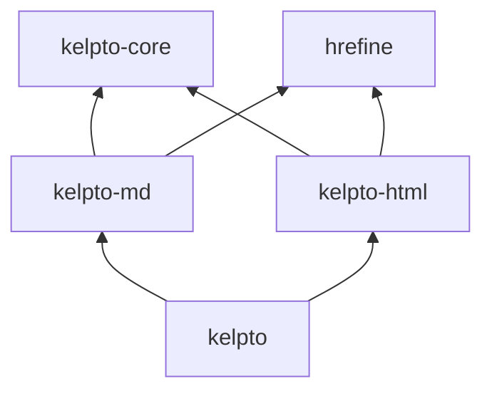

# Design sketch: each library alone, and together

A first sketch (2026-10-30). Nothing here is decided unless it says
so; it's meant to make the choices visible. See [plan.md](plan.md) for
goals and tests.

## Decided so far (the user, 2026-10-30)

- **Four libraries,** with a separate `kelpto-core`.
- **URLs are a wrapper on `String` for now** (say `LinkTarget`), with
  no URL processing yet; revisit later. If Hrefine comes in, it comes
  as a git submodule, and some of its Unicode processing might be
  extracted for shared use.
- **Order:** settle how kelpto-md and kelpto-html coordinate, then
  build the Markdown side only.
- **Red-green trees from the start,** as in "Edits without heavy
  copying", below, since retrofitting positions is hard.

## Status (2026-10-31)

Real, tested Temper in all four libraries. Each library's README shows
it in use, and the top README shows them alone and together.

- **kelpto-core:** red-green trees (`GreenNode`, `GreenToken`,
  `GreenNodeBuilder`, `RedNode`, and `RedToken`), `Span`, and `Kind`,
  with `replaceWith` copying only the path to the root. Everything
  reads text by `StringIndex`; nothing decodes it.
  Also HTML's character references (named ones from html5lib-tests,
  each with a flag for HTML's forms without `;`, and numeric ones), and
  Unicode 18's punctuation, whitespace, and full case folding, as small
  generated tables read in place (see "Generated tables", below).
  Kinds are small classes with an id and a name, so names travel with
  nodes into dumps and test failures; they compare by id, since
  Temper has no `==` on class instances. Each library takes a range of
  ids (core 0 to 99, md 100 to 199, html 200 to 299).
- **kelpto-md:** all of CommonMark 0.31.2, lossless: blocks by the
  spec's two-phase algorithm (see "kelpto-md's blocks", below), and
  inlines by its delimiter algorithm (see "kelpto-md's inlines").
  Typed views by where a node may go (`BlockChild`, `ListChild`,
  `ParagraphChild`, and `LinkTextChild`); edits `Heading.withText` and
  `withLevel`, `CodeBlock.withInfo`, and `withDestination` on
  definitions, inline links, and images; rendering with raw HTML
  escaped unless `withRawHtmlTrusted()`. Every view has
  `descendants`, `parent`, and `depth`, and `MarkdownEditor` makes
  many edits in one pass (see "Walking and batch edits", below). All 652 of the spec's
  examples pass, in `tests/commonmark/`. GFM's extensions are opt-in
  (see "kelpto-md's GFM extensions", below).
- **kelpto-html:** the WHATWG tokenizer in full, lossless, with parse
  errors kept beside the tree (see "kelpto-html's tokenizer", below),
  typed views (`StartTag`, `EndTag`, `Comment`, `Text`, `Doctype`,
  `ProcessingInstruction`, `DroppedTag`, and `Attribute`), and
  `Attribute.withValue`; and tree construction's first part,
  `parseHtml`, building the tree browsers build beside the tokens,
  with `Element` and the other built nodes pointing back at them (see
  "kelpto-html's tree construction", below); and `sanitizeHtml`, a
  sanitizer on the built tree (see "Sanitizing").
- **kelpto:** `ParsedRawHtml`, `parseMarkdownWithHtml`, `htmlOf`,
  `buildHtml` (Markdown and raw HTML as the one tree a browser builds,
  see "Raw HTML in Markdown, as one tree"), `markdownNodeOf`,
  `fragmentOf`, and `renderSafe`, sanitizing the built tree (see
  "Sanitizing", below).

**How they coordinate:** kelpto-md defines two interfaces and never
imports kelpto-html.

- **`RawHtmlHandler`** gives the children of each `RawHtml` node and
  `HtmlBlock`. The default, `OpaqueRawHtml`, keeps one token; kelpto's
  `ParsedRawHtml` gives kelpto-html's green subtree, so the HTML sits
  in the Markdown tree, lossless. kelpto-md checks the children's text
  matches and falls back to opaque if not, so a faulty handler can't
  lose text. HTML split by container prefixes (an HTML block in a
  block quote, say) stays opaque text between them for now.
- **`RawHtmlRenderer`** renders each `RawHtmlContent` (inline or a
  block): escaped by default, as written with `withRawHtmlTrusted()`,
  or as written for `buildHtml`, whose tree `renderSafe` sanitizes.
- **Shared red nodes:** kelpto-html's views wrap any red node of its
  kinds, so `htmlOf(rawHtml)` views the subtree in place, and an HTML
  edit there gives a new root that `new MarkdownDocument(top.node)`
  views as Markdown again.

Every input prints back exactly: text a parser doesn't understand
stays text. Tests in each library check roundtrips on ordinary, odd,
and invalid input, the typed views, that edits change only their span,
and rendering defaults.

### kelpto-md's blocks

- **Two passes:** the first follows cmark's block algorithm line by
  line, recording for each line its container prefixes (each `>`, list
  marker, and indentation, with the block it belongs to) and which
  leaf takes the rest. The second writes the green tree from that, so
  every code point lands in one token.
- **Positions are `StringIndex`es** into the source string: both
  passes and the inline parser read it directly, with no decoding, and
  a line table comes from `indexOf` on `\n` and `\r`. A paragraph's
  inline content is the source string itself when its lines follow
  each other there, each ending in `\n`; otherwise (container prefixes,
  indentation, or `\r\n`) its lines are joined into a new string by
  `\n`. Code points are counted only where the spec counts them.
- **Prefixes where they fall:** a container's prefix on its first line
  is in its own node; on later lines it's a token in whatever node is
  open there, such as a paragraph spanning lines. Views skip them.
- **Tabs:** kept as written, with columns counted as the spec says. A
  tab partly used by a prefix goes to the block after it as a
  `TabRemainder1` to `3` token, which code shows as that many spaces.
- **Blank lines and definitions** are nodes, so they keep their text;
  a list's tightness is computed from where blank lines are, so it
  follows edits.

### kelpto-md's inlines

- **One pass, then emphasis,** as cmark does: a left-to-right scan
  making items (ranges of the paragraph's text, or nodes holding
  items), with stacks of delimiter runs and brackets, then the spec's
  "process emphasis". `TreeWriter` writes the items as tokens, so line
  breaks and prefixes inside them land as in blocks.
- **Lossless:** delimiter runs are text, with only the `*` or `_` that
  emphasis uses in `EmphasisMarker` tokens; links keep their
  brackets, parentheses, whitespace, destination, title, and label as
  tokens; a character reference keeps its text, with its value a view.
- **References** resolve when the tree is read: the parser needs only
  which labels the document defines, and a reference link's
  destination is its definition's, so it follows edits to the
  definition. `LinkTarget` stays as written (escapes and references
  resolved); the renderer percent-encodes only when it writes HTML.
- **Linear,** checked on cmark's pathological shapes: `openers_bottom`
  for emphasis, link openers deactivated by a mark rather than one by
  one, and failed searches for closing backticks or HTML ends not
  repeated.

### kelpto-md's GFM extensions

- **Opt-in, by parser:** `MarkdownParser.gfm` has all four syntax
  extensions and footnotes (an option in cmark-gfm, but on at GitHub),
  `MarkdownParser.commonMark` none, and `withTables`,
  `withTaskListItems`, `withStrikethrough`, `withExtendedAutolinks`,
  `withFootnotes`, and `withRawHtmlHandler` change one, as Hrefine's `UrlPolicy` does,
  so no named arguments are needed. `parseMarkdown` is `commonMark`.
  The disallowed raw HTML filter is on rendering,
  `withDisallowedRawHtmlFiltered()`, wrapping the `RawHtmlRenderer`.
- **As cmark-gfm 0.29.0.gfm.13 does it,** odd corners included (tables
  stop filling short rows after 524,288 empty cells, `~` runs read 100
  at a time, emails found in text after the rest, a footnote
  reference's label taken as written whatever markup it holds, and
  `![^` never an image in a GFM document, footnotes or not), since
  GitHub renders by it. All of GFM's spec examples, cmark-gfm's
  extension tests, and all its regression tests pass, in `tests/gfm/`.
  Some choices differ:
  - Task list items work inside block quotes and on a nested item's
    line, where cmark-gfm, looking from the line's start, misses them.
  - A footnote reference needs its `^` written as is and can't span a
    line break, where cmark-gfm garbles or drops the text.
  - Raw HTML, in blocks or inline, renders with the line endings inside
    it as written, `\r\n` and `\r` included, where cmark-gfm (and
    cmark) write `\n`: kelpto-md writes the HTML as the source has it.
    This holds in CommonMark documents too.
  - Links don't nest. After a link, cmark-gfm makes the `[` openers
    before it active again once a new `[` comes, so `[a [b](/c) [d]
    e](/f)` is a link holding a link; kelpto-md keeps CommonMark's
    rule, since its typed views say links can't nest
    (`LinkTextChild`).
  - `*~~ a \**` is emphasis, as CommonMark's delimiter rules give,
    where cmark-gfm leaves plain text.

  The kelpto-md README lists these for users.
- **Lossless:** a table is a leaf block whose lines are row nodes, with
  `Pipe`, `TableDelimiter`, and cell nodes; a backslash before `|` in a
  cell is a `PipeEscape` token, since GFM drops it before reading the
  cell. Task markers are tokens in their item, strikethrough's runs
  `StrikethroughMarker` tokens, and each extended autolink style a
  node kind. A footnote definition is a container like a block quote,
  `[^`, its label, `]`, and `:` tokens on its first line; a reference
  is `FootnoteOpen`, `LabelText`, and `LinkClose` tokens, whether or
  not a definition has its label.
- **Edits reparse as parsed:** the root's kind records the inline
  extensions, footnotes included, so `Heading.withText` and `TableCell.withText` escape
  `~` (and `|` in cells) only where needed.
- **Rendered as cmark-gfm renders:** a document parsed with any
  extension on (its root's kind says so) renders a strong directly
  inside another strong without its own tags, as cmark-gfm's renderer
  does (`src/html.c`, since 0.29.0.gfm.10), so `****foo****` gives one
  `<strong>`. The tree keeps CommonMark's nesting; plain CommonMark
  documents render it as CommonMark does. Footnotes resolve when
  rendered, as links do: definitions stay where written in the tree,
  and those referred to render in a section at the end, numbered by
  first reference (in definitions too, used or not), with backlinks;
  a reference without a definition renders as its text.
- **No cost when off:** each check is behind its flag, and only `~`,
  `:`, and `w` gain cases in the inline scan, and `!` a check for `^`
  in any GFM document. Footnotes add a check at `]` after links fail
  and at the block starts, and one walk of the tree when rendering,
  only in documents parsed with them.
  Nested references stay linear: inner ones are dropped, not
  rescanned.

### kelpto-html's tokenizer

Built 2026-11-03, against html5lib-tests' tokenizer tests (in
`tests/html5lib-tokenizer/`).

- **The standard's state machine, one loop:** states are `Int`s, for
  `when`, and one loop in `run` reads the input by `StringIndex`, with
  the positions it needs (where a tag, name, or comment's closing
  dashes start) in locals. Hot states (data, RCDATA, tag and attribute
  names, values, comments) scan ahead in an inner loop. Character
  references, the RCDATA and script end tag states, and the script
  double escape states read ahead instead of being states: what they
  read only ever becomes text or the tag they find, so the tokens and
  errors are the same.
- **Slices, not buffers:** the standard builds each token a character
  at a time; here each part (a tag name, an attribute value with its
  quotes, a comment's text) is one slice of the input, added through
  the builder's cache, and what browsers read from it (lowercase
  names, decoded references, `\n` for `\r\n` and `\r`, U+FFFD for NUL
  where the standard replaces it) is worked out by the views when
  asked. Nothing is allocated per character; an attribute's name is
  lowercased once, to find duplicates.
- **Kinds decided late:** a node's kind is sometimes known only after
  its tokens: a repeated attribute (`HtmlDuplicateAttribute`, which
  `attributes` skips, as browsers drop it), a tag cut off by the end of
  the input (wrapped in `HtmlDroppedTag`, with `</>`), and a DOCTYPE
  with force-quirks set (`HtmlQuirksDoctype`). kelpto-core's builder
  gained `checkpoint` and `startNodeAt` for this, as rowan has.
- **Parse errors beside the tree:** `HtmlTokenizer.tokenize` gives
  `TokenizedHtml`, the tokens and a list of `HtmlParseError` (the
  standard's code, and an offset in code points, counted once at the
  end). Errors don't take text, so they aren't tokens; `tokenizeHtml`
  gives only the tokens, as before.
- **Driven by tree construction:** two parts of the tokenizer belong
  to tree construction: the state after a start tag, and whether
  `<![CDATA[` is CDATA (in SVG and MathML). `parseHtml` hands each
  top-level token to tree construction through a `TokenSink` as soon
  as it's done, and the sink gives the state for each start tag and
  answers the CDATA question from the adjusted current node. On its
  own, `HtmlTokenizer.html` switches after the start tags tree
  construction switches after in HTML content (`script`, `style`,
  `title`, `textarea`, and the others), and CDATA is always a bogus
  comment. `withStateSwitching(false)`, `withInitialState`, and
  `withLastStartTag` set it up as html5lib-tests do.
- **Processing instructions,** as the standard reads them since
  whatwg/html#12118 (merged 2026-06-25, with #12653, #12654, and
  #13037; the user's decision, 2026-11-03): `<?` opens, the first `>`
  closes (the characters a bogus comment took before), and the target
  is ASCII letters, digits, `-`, and `_`, starting with a letter or
  `_`. Its case is kept: the standard doesn't lowercase it, and WPT's
  tests expect `<?UPPERCASE ?>`. A `?` before the `>` isn't data. `<?`
  without such a target, or with `xml` or `xml-stylesheet` (any case),
  is a bogus comment as before, and one cut off by the end of the
  input is dropped (an `HtmlDroppedTag`, as for tags). All of
  html5lib-tests' tokenizer tests pass; three in domjs.test still
  expect the old error code for `<?`, and the runner expects the new
  one there. Printing keeps the bytes as written; anything writing a
  processing instruction fresh (the built tree's serialization) ends
  it in `?>`, which XML reads too.

### kelpto-html's tree construction

Started 2026-11-03 (whole documents, every insertion mode, foreign
content), with fragments 2026-11-04; not yet tree construction's parse
errors. Checked against WPT's tree construction tests (in
`tests/wpt-tree-construction/`).

- **A built tree beside the token tree,** not views over it: the
  standard's tree can't be read off the tokens' nesting (implied
  `html`, `head`, `body`, and `tbody`, foster parenting, the adoption
  agency algorithm, attributes of a second `<body>` merged into the
  first), so tree construction builds its own tree as tokens arrive,
  and each node points back at the token it came from: an element at
  its start tag (`Element.startTag`, null where implied; remade
  formatting elements share their original's), a comment, DOCTYPE, or
  processing instruction at its token. The tokens stay the lossless
  tree, so `asWritten` and token edits work as before; the built tree
  is what browsers see, for reading, sanitizing (see "Sanitizing"), and
  serializing (`html`, the standard's serialization, normalized).
- **An arena, not node objects:** parallel lists of each node's kind,
  name, namespace, parent, first and last child, siblings, token,
  attributes, and text, with nodes as `Int`s. The adoption agency
  algorithm and foster parenting move nodes, which is a few list
  writes here; there are no parent pointers to make cycles (which
  `Arc` and `shared_ptr` would leak), and no object per node to
  collect. Views (`Element`, `BuiltText`, `BuiltComment`,
  `BuiltDoctype`, and `BuiltProcessingInstruction`, names provisional)
  wrap the arena and a node's number.
- **Insertion modes as Temper:** one method per mode, as the standard
  lists them, each taking the current token and giving whether to
  reprocess it (in whatever mode it switched to), so "process using
  the rules for in body" is a plain call. The dispatcher picks foreign
  content by the adjusted current node, as the standard says. The
  stack of open elements and the list of active formatting elements
  are `ListBuilder<Int>`s (a marker is -1), and scopes walk the stack.
- **Tokens a run at a time:** text arrives as a run, decoded by the
  `Text` view (references, `\r\n`, NUL as the standard has them), and
  the rules split off what they treat differently (leading
  whitespace, NUL), rather than a call per character. One token
  object is reused for every token, so the per-token allocations are
  its view and each attribute's name and value.
- **What's lossless:** the tokens, always. The built tree keeps where
  each node came from, not how it was written; attributes are decoded
  values.
- **Fragments,** by the standard's fragment parsing algorithm, as
  `innerHTML` parses: `parseHtmlFragment(text, context)` and
  `HtmlParser.parseFragment`, giving `HtmlFragment` (tokens, built
  nodes, and errors, as `HtmlDocument` has them). A `FragmentContext`
  is the context element without a DOM: its name, namespace,
  attributes (for `annotation-xml`'s `encoding`), whether it's in a
  `form`, and its document's quirks mode; `Element.fragmentContext`
  reads all of them off a parsed element. The builder puts an `html`
  root on the stack, keeps the context as a detached arena node (the
  adjusted current node while the root is alone on the stack, and the
  node the insertion mode reset reads last), points the form element
  pointer at the context or a detached stand-in for its form, and
  starts the tokenizer in the context's state (RCDATA in `textarea`,
  and so on), with no last start tag, so no end tag closes it. The
  standard's other fragment cases (`</html>` after body, `</frameset>`,
  `<input>` and `<select>` in a `select` context, and "parsing template
  contents" for a `template` context) are each a check of the context.
  `html` serializes the nodes as the context's contents, so text in a
  `script` context stays raw.
- **Customizable select (2026-11-04):** a `<selectedcontent>` in a
  `select`'s `button` holds a copy of the selected `option`'s
  contents. The standard runs this in the DOM (the selectedness
  setting algorithm as each option is inserted, a copy as a
  `selectedcontent` is inserted, and again as the selected option is
  popped off the stack); the builder runs the same steps as it goes,
  from the tree so far, paying one check per element until a `select`
  appears (see "Customizable select" in `build.temper.md`). The copies
  are synthetic built nodes: the tokens, the lossless tree, have only
  the original, and each copy has its original's origin (so
  `Element.startTag` gives the original's start tag, as remade
  formatting elements do) and `BuiltNode.clonedFrom`, the parsed node
  it copies (null for the rest). The sanitizer judges copies as any
  node, so a copy of disallowed content goes as the original does,
  and each is listed in `removals` with the original's origin. Not
  done: updates the standard queues as script moves or removes
  options, which a parse doesn't do short of the adoption agency
  algorithm moving a block with options in it.
- **Not yet:** tree construction's parse errors (only the tokenizer's
  are kept),
  `<template shadowrootmode>` (declarative shadow roots) and
  `<template for>` patching, which the WPT `.dat` tests don't check,
  and an end tag's link to the element it closed.
- **Tests:** all 1,761 of WPT's document tests (not scripted_*.dat)
  give the expected tree, and all 206 fragment tests.

### Raw HTML in Markdown, as one tree (built 2026-11-04)

How `kelpto` parses a Markdown document's HTML blocks and inline HTML
into the tree a browser builds from its rendering, still lossless:
`buildHtml(doc, context, renderer)`, giving a `BuiltHtml`.

- **Why one parse, not one per piece:** a browser reads the rendered
  page as one stream, so pieces interact: `<b>` in one paragraph and
  `</b>` in the next, `
` in one HTML block closed in another, a
  `<table>` foster parenting the Markdown text after it, or a
  `<script>` or `<textarea>` left open, reading the Markdown after it
  as raw text. Parsing each piece as its own fragment (`fragmentOf`:
  context `p` for inline HTML, `body` for blocks) gets the common case
  right and is cheap, so it stays as a view for tools looking at one
  piece; but sanitizing has to judge the tree the browser builds, so
  `renderSafe` needs the joined one.
- **The renderer hands over parts:** `MarkdownRenderer.renderTo(doc,
  sink)` gives a kelpto-md `RenderSink` each start tag (its name and
  the whole tag as written), end tag, run of text (unescaped), and
  raw HTML piece (with what the `RawHtmlRenderer` gave), each with its
  Markdown view; `render` writes the same parts into a string, so the
  two can't drift apart, and plain rendering costs one null check per
  part more.
- **One fragment parse over two kinds of token:** kelpto-html's
  `FragmentStream` (one `TreeBuilder`, started as a fragment in the
  caller's context, `body` by default) takes synthetic tokens for
  what Markdown renders (`
`, `<em>`, text, a code block's
  `<pre><code>`), each pointing at its Markdown node, and, for each
  raw HTML piece and each tag with attributes, its text, tokenized
  where the last piece left off. So the built tree is exactly what
  parsing the rendered HTML gives: the spec tests check every
  CommonMark and GFM example that way.
- **The tokenizer's state carries over:** each piece starts in the
  data state with the last start tag; a piece's last token waits
  until the piece ends. Where a piece leaves the tokenizer in raw
  text, RCDATA, script data, PLAINTEXT, a comment, a CDATA section, or
  a tag cut off (or ends in `<` or `</`), that token isn't taken, and
  from its start on the stream keeps the HTML text of everything it's
  given, synthetic tokens written as the renderer writes them, and
  tokenizes it all at the end, each token pointing at the origin of
  the part it starts in. Rare in real documents, but exactly the case
  a sanitizer must not miss.
- **Pointing back:** in a joined parse the arena's token index is into
  a table of origins (`BuiltTree.origins`), each a red node: a
  kelpto-html token inside the Markdown tree (the raw piece's tokens
  as `ParsedRawHtml` put them there, while the joined parse reads them
  the same, as it does unless foreign content or carried state reads
  them otherwise), or a Markdown node. `BuiltNode.origin` gives it for
  any built node, `Element.startTag` still finds a raw start tag, and
  kelpto's `markdownNodeOf` gives the Markdown view (the `RawHtml` or
  `HtmlBlock` around a raw token). The lossless tree stays the
  Markdown tree, with the HTML tokens inside it; the built tree is
  beside it, built only when asked.
- **Not kept:** parse errors of a joined parse; and a raw token in
  carried text points at its piece, not a token.
- **Edits:** changing a raw piece's tokens or a Markdown node rewrites
  only that text, as now; the built tree is reparsed, not patched.

### Sanitizing (built 2026-11-04)

kelpto-html's sanitizer (`sanitize.temper.md`), and kelpto's
`renderSafe` over it.

- **The built tree, never the text:** `sanitizeHtml(text, policy,
  context)`, and `sanitize(policy)` on `HtmlFragment`, `HtmlDocument`
  (its body), `FragmentStream`, and kelpto's `BuiltHtml`, walk the
  arena of the tree a browser builds. `renderSafe(doc, policy,
  context)` is `buildHtml(doc, context).sanitize(policy)`: raw HTML
  trusted into the one tree, then judged there with the Markdown, so
  pieces that only do harm together (an attribute or a comment open
  across paragraphs, a `<plaintext>` or `<textarea>` swallowing what
  follows, foster parenting) are judged as the browser joins them.
- **An allowlist, as a value:** `SanitizerPolicy.standard` keeps what
  Markdown and GFM render (footnotes' ids, classes, and `data-`
  attributes, task list checkboxes, table alignment, and `ol start`)
  and common formatting (`abbr`, `details`, `kbd`, `picture`, `sub`,
  `sup`, and so on), with `id`, `class`, `title`, `lang`, and `dir` on
  any of them; `textOnly` keeps text. `withElements`,
  `withoutElements`, `withAttributes(element, names)` (`"*"` for
  any), `withoutAttributes`, `withSchemes`, and `withUrlCheck` give a
  new one. Not allowed: an element is dropped with its contents if
  those aren't plain HTML or it would change the page (`script`,
  `style`, `template`, `iframe`, `object`, `embed`, `noscript`,
  `textarea`, `title`, `base`, `meta`, `link`, frames, plug-ins), or
  are copies (`selectedcontent`, whose copied `option` stays), or
  else replaced by its children. Forms (`select`, `option`, `button`)
  aren't in `standard`, so a `select` leaves its options' text. Comments, DOCTYPEs, and processing
  instructions go (as "Secure defaults" asks); `input` stays only as
  a checkbox; `srcdoc`, SVG's `script`, and its animation elements
  are never kept. SVG and MathML are dropped unless allowed by
  namespaced names (`svg:circle`), since they're parsed otherwise than
  HTML: namespace confusion and mutation XSS attacks on sanitizers use
  exactly that.
- **Links:** every URL attribute kept (`href`, `src`, each `srcset`
  candidate, `cite`, `action`, `formaction`, `poster`, `xlink:href`,
  `ping`, and the obsolete ones) goes through the policy's `UrlCheck`,
  which gives the URL to write or null to drop the attribute. The
  default, `SchemeUrlCheck`, allows `http`, `https`, `mailto`, and
  relative URLs, reading the scheme as the URL standard does
  (`urlScheme`: C0 controls and spaces trimmed, tabs and newlines
  ignored anywhere, case folded), on attribute values the tree has
  already decoded, so `java&#x09;script:` and `&#106;avascript&colon;`
  are `javascript`. URLs stay strings (decided above).
- **Where Hrefine plugs in:** as a `UrlCheck`, from the `kelpto`
  library (or a policy passed in), so kelpto-html needs no Hrefine
  unless a caller brings it. Hrefine would parse each URL as browsers
  do, check host and scheme (tricky hosts, IDN spoofing), and could
  give back a normalized URL. Until a `srcset` rewriter exists, a
  check changing a URL inside `srcset` drops the attribute.
- **Reparse check, at run time:** the output is parsed again as a
  fragment in the same context, scripting on, and sanitized again; it's
  returned only when that changes nothing and serializes the same, or
  else goes round again (4 times at most) before falling back to the
  text alone. So the output always parses to exactly the tree it was
  serialized from, all allowed, whatever the sanitizer's own unwrapping
  does (`
<button>
` unwrapped gives `

`, which the
  browser reads as two `p`s) or the input tries. It costs one more
  fragment parse of the output: in Python, on the CommonMark spec
  (best of 3, one noisy machine), `renderSafe` took 2.1 s, of which
  building the tree 0.7 s, the reparse 1.1 s (an HTML parse of the
  224 KB output, dearer than the Markdown parse), and the two walks
  the rest; `buildHtml` alone 0.7 s. Kept on anyway, since it's the
  only check that doesn't depend on the sanitizer getting every
  parsing rule right too. If it matters, a later fast path could skip
  it when the first walk only dropped attributes, once that's shown
  to round-trip for the standard policy.
- **What was removed:** `SafeHtml.removals` lists each element (dropped
  or unwrapped), attribute, refused URL, and comment, DOCTYPE, or
  processing instruction, in document order, with its name, element,
  value, and origin (the start tag or Markdown node, as
  `BuiltNode.origin`). Always on, since it costs one object per
  removal and nothing when nothing goes; the output is unchanged.
  Origins are null for implied elements, for `sanitizeHtml` (no tokens
  kept), and for the rare removals of the reparse rounds.
- **Iterative:** one loop with a stack, so deep nesting can't overflow
  the call stack.
- **Tests:** a gallery of hostile Markdown (kelpto's `safeGallery`,
  for the site's `#safe`), hostile HTML in kelpto-html, each output
  checked to reparse to itself, and every CommonMark and GFM example
  without raw HTML or a link outside the allowed schemes rendering the
  same tree safely as trusted. Public sanitizer suites didn't fit:
  html5lib-python's sanitizer tests check its own allowlists and
  escaping (disallowed tags shown as text), and DOMPurify's need
  asking first.
- **Not yet:** an id prefix against DOM clobbering, CSS (the `style`
  attribute and element are all or nothing, and unchecked if allowed),
  `rel` on links, and a `srcset` rewriter.

### Generated tables

Scripts in `scripts/` write them into kelpto-core from pinned sources,
checking every entry as the Temper code reads it:

- **`unicode-tables.temper.md`** (`unicode_tables.py`): punctuation
  (P and S, 359 ranges) and full case folding (C and F, 313 entries
  for 1,606 code points) as base-32 strings in chunks of 16, found by
  binary search over a short list of chunk starts, then read in
  place; whitespace as 9 ranges. 2,947 characters of strings, 4.8 KB
  of source.
- **`entities.temper.md`** (`character_references.py`): the 2,125
  named references, sorted and front-coded, 14,263 characters, read
  into a map when the library loads.

### Walking and batch edits

- **A flat list, not a visitor:** `descendants` gives every view
  inside a node in document order, each before what it holds, made
  straight from the green children. A list reads the same in all
  seven languages, filters with each one's own tools, and needs no
  callback mutating captured state, which Rust's `Fn` and Java's
  lambdas make awkward. `parent` and `depth` walk up the red parents,
  skipping `InlineContent`, so views hold no parent fields.
- **Edits as replacements:** each `with…` edit works out a kelpto-core
  `Replacement` (a red target and its new green element) and applies
  it. `doc.editor()` collects them instead, and `toDocument()` calls
  `replaceAll`, which sorts the targets' paths and copies each node on
  them once: one pass, however many edits, all worked out against the
  original document, so nothing is walked again. Overlapping edits
  bubble, as do views from another document, as far as a check of
  kinds and widths along each path sees.
- **Inserting and removing blocks** (2026-11-03): the editor's
  `insertBefore`, `insertAfter`, `replace`, and `remove` take a block
  and a `MarkdownBuilder`, so the editor and builder share content
  types, with one class to create and one to change. They become
  kelpto-core `Splice`s (a range of a node's children and what replaces
  it), made in the same pass as replacements by `editAll`. Edits are
  grouped by container and worked out when `toDocument()` runs,
  against the blocks the container will hold, so neighbors are judged
  as they'll be. The new lines are parsed inside the same containers,
  opened on a line of their own between two empty headings, so their
  green nodes, container prefixes included, are what parsing the
  edited text gives; the rest stays shared and byte for byte.
  Blank lines set new blocks apart (making a tight list loose), and
  removing a block leaves one where neighbors would touch; blank lines
  after a list go inside it, as parsing puts them. What would still
  read otherwise bubbles: lists joining (the builder picks a marker
  unlike its neighbors' first), an indented block after a list, a
  footnote definition, or indented code, anything after an unclosed
  fence or HTML block, an emptied container, a task item's first
  block, and removing a definition a reference still needs. A random
  test checks edits in every kind of container against a full reparse.
- **Content as `Inlines`:** `setContent` and `withContent` on
  headings, paragraphs, and table cells write `Inlines` as the
  builder does; `setText` and `withText` stay for plain strings.
  A paragraph's new lines take its container's prefixes, parsed in
  place as above. Not yet: link text, list items as targets (they need
  the list's marker, numbering, and tightness), and tabs in a list
  item's prefix (those bubble).
- **Real documents:** `tests/samples` runs a scrape and a transform on
  the CommonMark spec and some READMEs, checking that only the edited
  bytes change; the benchmarks will use the same files.

### Building documents

Built (2026-11-03), open to review: `MarkdownBuilder` and `Inlines`, in
`kelpto-md/build.temper.md`, write a document from plain strings, so
user text never needs hand-escaping.

- **Shape:** builders, as `doc.editor()` is, not named arguments or
  first-class symbols. The two share content: the editor inserts what
  a `MarkdownBuilder` built, and sets a heading's, paragraph's, or
  cell's content from `Inlines`, so a builder creates and an editor
  changes, with the same escaping. `MarkdownBuilder`'s methods add a block each
  and return nothing (`heading(level, content)`, which bubbles outside
  1 to 6, `paragraph`, `codeBlock(info, code)`, `thematicBreak`,
  `blockQuote(builder)`, `bulletList(builders)`, and
  `orderedList(start, builders)`), then `toMarkdown()` or
  `toDocument()`. `Inlines` is a value, like `MarkdownParser`: from
  `Inlines.empty`, each of `text`, `code`, `emphasis`, `strong`,
  `link(content, target, title?)`, `image(alt, target, title?)`, and
  `lineBreak` gives new content, so calls chain. Content is always an
  `Inlines`, so there's one way to pass it. A builder keeps lists as
  their items until it's written, so their markers can be picked to
  differ from the blocks around them, in the builder or where an
  editor puts them.
- **A tree, then text:** `Inlines` keeps a small tree and writes it
  when a block takes it, since escaping depends on neighbors: `*` or
  `_` alternate so no two delimiter runs join, letters and digits
  next to a delimiter, and blanks where Markdown would drop them,
  become character references, so every delimiter flanks as needed;
  ASCII punctuation at a paragraph line's start is escaped, so no line
  starts a block. What can't be written (empty emphasis or code, a
  break ending a paragraph, a link in a link) is left out or flattened.
  Emphasis two deep is parsed back and, if it reads otherwise, written
  again with other delimiter choices; emphasis inside emphasis of its
  own kind can still, rarely, read back otherwise (a delimiter run
  that can both open and close, which CommonMark's rule of 3 then lets
  close the outer one).
- **The same in CommonMark and GFM:** `~` is escaped, and `@`, `:/`,
  and `www.` never start an extended autolink.
- **Checked** by building hostile strings into every place text goes,
  and 400 random inline trees (emphasis never inside its own kind),
  parsing them with both parsers and comparing the views, and the
  HTML for plain text, with what was built.
- **Later:** tables and task list items (cells are `Inlines`
  already escaping `|`), strikethrough, link reference definitions,
  raw HTML from a trusted or kelpto-html source, and Mike's context
  for anchors and shared link names.
- **Later, from Mike's design ideas** (a plan, 2026-11-03; the views
  already follow his sealed interfaces by where a node may go:
  `BlockChild`, `ListChild`, `ParagraphChild`, `LinkTextChild`):
  - **Typed nesting when building:** content types per position, so
    invalid nesting fails to compile rather than escaping or bubbling
    (link text can't hold a link, a heading holds no blocks). Today
    one `Inlines` serves every inline position.
  - **Foreign content:** HTML from a kelpto-html tree or builder, or a
    `SafeHtml` (secure-composition), as a block or inline; and fenced
    blocks from any typed source (Mermaid, say) through a small
    interface giving an info string and text, with the fence chosen
    to fit, as `codeBlock` does now.
  - **A link context,** shared by a page or a set of pages: anchors
    allocated before their heading exists (usable by links before and
    after it, and from other pages), never colliding; and named
    external URLs, written as reference links with their definitions
    gathered at the page's end. CommonMark headings have no ids, so
    an anchor either predicts the slug a renderer gives (GitHub's,
    with its `-1` suffixes; the context reserves slugs) or writes an
    explicit HTML anchor; the context picks per target.
  - **A block-style builder:** nested content as trailing blocks
    (`b.blockQuote { q => ... }`) as well as sub-builders, close to a
    Kotlin DSL while translating to plain lambdas everywhere.
  - **Tagged strings:** an `md"..."` accumulator through
    secure-composition's contextual autoescaping, escaping each
    interpolation for where it lands (heading, link text, URL, code
    span), using this builder's escaping rules per context.

**Immediate-mode users** (a note, 2026-11-04): Kelpto keeps a lossless
tree of documents that exist as text. Immediate-mode HTML (htpy, maud,
templ, React-style views) generates HTML from state on each render and
keeps nothing. The two meet where a view embeds a document: render
Markdown inside a view, memoized by a hash of its content. Safety
there comes from the planned sanitizer bridge to secure-composition's
`SafeHtml`, a separate small adapter, as "Foreign content" above has
it. An emit-only builder for these users is an open question in
[plan.md](plan.md).

**Next,** roughly in order:

1. More edits: link text, titles, and emphasis, and list items as
   targets of the editor's block edits. Done: edit batches
   (`doc.editor()`), building from scratch (`MarkdownBuilder`), and
   inserting, replacing, and removing blocks, with `Inlines` content
   for headings, paragraphs, and cells (2026-11-03).
2. The WHATWG tree construction, against WPT's `.dat` files, driving
   the tokenizer's state. Done for documents (2026-11-03) and
   fragments (2026-11-04), and Markdown's raw HTML as one tree (see
   "Raw HTML in Markdown, as one tree", 2026-11-04).
3. A real sanitizer on the built tree (`buildHtml`'s), with links
   checked, replacing the `renderSafe` sketch. Done (2026-11-04; see
   "Sanitizing"), with links checked by scheme until Hrefine comes in.
4. Chunked children, once documents are big enough to measure;
   interning is done (see "Less memory", below); deep nesting (thousands of emphasis levels, and views and
   rendering of deep blocks) without deep recursion. Parsing and
   printing deep block nesting are done: linear, with no recursion.
5. GFM's rest: more edits for tables (rows and columns). Footnotes
   are done. Fix two differences from cmark-gfm in GFM documents: a
   `\|` ending an extended autolink in a table cell should leave the
   link (`www.x.y\|` links `www.x.y`), and a paragraph that is only a
   link definition directly before a table stays text.
6. Benchmarks: done (2026-11-02; [benchmarks.md](benchmarks.md),
   `bench/`, and `scripts/bench.py`). A first tuning followed the
   same day: paragraphs share the document's decoded code points
   instead of decoding again, deep block
   nesting is linear, and the block and inline parsers' per-character
   loops work on locals, which Rust's translation locks for on every
   field access. The block parser and tree writer read the source
   string by `StringIndex` (2026-11-03), and then the inline parser
   too, so nothing is decoded. That made C++ much slower, though: its
   translation copies a `String` on every call and local, so reading
   the source through helpers is quadratic there (about 24 times
   slower on the spec; [benchmarks.md](benchmarks.md)), until Temper
   passes strings by reference. Next: the Rust translation's locks
   elsewhere (Rust is still several times slower than C++ from the
   same source), C#'s and Lua's garbage on long documents, Python's
   checked integer arithmetic, and GFM benchmarks.
7. Typed walks: descendants of one kind (`doc.descendantsOf…`, or a
   filter per view type such as `headingsIn`), so users get typed views
   without casts (Rust needs `temper_core::cast` today) and, if
   benchmarks say so, without building the whole list.

## Libraries and layout

One repo, one Temper worktree, libraries in subdirectories, versioned
together:

| Directory | Package | What it is |
|---|---|---|
| `kelpto-core/` | `kelpto-core` | Spans, the lossless tree's shared interfaces, and HTML's character references. Small, with no dependencies. |
| `kelpto-md/` | `kelpto-md` | CommonMark, lossless: parse, edit, print, and render. |
| `kelpto-html/` | `kelpto-html` | The WHATWG HTML parser, lossless, plus a sanitizer. |
| `kelpto/` | `kelpto` | Both together: HTML inside Markdown understood as HTML, and safe rendering of Markdown in one call. |

Dependencies go one way, so there's no cycle:

Why four rather than two: Markdown alone shouldn't carry an HTML
parser (most of the size), and HTML alone shouldn't carry a Markdown
parser, yet both need spans, the same tree interfaces, and the
character references (about 2,200 entries). `kelpto-core` is that
shared part, and most users never name it. The umbrella package takes
the plain name, `kelpto`, so "install kelpto" gets everything.

## Shared ideas (kelpto-core)

- **Spans:** `Span(start, length)` in code points of the input, as in
  Hrefine's `SourceSpan`, ideally the same type shared across both
  libraries.
- **Lossless nodes:** every node can print exactly the text it was
  parsed from (`asWritten`), trivia included, and knows its span.
  Printing an unchanged tree gives back the input byte for byte.
- **Immutable trees, edits by replacement:** `doc.replace(node, new)`
  gives a new document whose text changes only inside `node`'s span;
  nodes are values, safe to share across threads, as Hrefine's `Url`
  is. Building a node from scratch gives it canonical text. Kept cheap
  as in "Edits without heavy copying", below.
- **Two outputs, never confused:** `asWritten` (the source, exactly)
  and a normalized form (`format()`), each named for what it is.
- **Character references:** the table and decoding, used by both
  parsers.

## Edits without heavy copying

Deeply immutable documents can make editing awkward and, done
naively, copy a lot and make much garbage. The proven answer for
lossless syntax trees is the red-green design of Roslyn (C#) and
rust-analyzer's rowan:

- **Green nodes, immutable and shared:** each node holds only its
  kind, its children, and its total width in code points, not its
  position. Tokens (leaves) hold their text. A green node never knows
  where it is, so the same node can be shared by many versions of a
  document, and identical small elements are shared (see "Less memory").
- **Red nodes, cheap views:** made on demand as you walk, each wraps a
  green node with its parent and absolute offset. They're the API users
  see (parent, position, and siblings) and are thrown away freely.
- **An edit copies only one path:** replacing a node builds new green
  nodes from it up to the root, and everything else is shared. Markdown
  trees are shallow (a document, a block or two of nesting, inlines),
  so that's a handful of nodes per edit. Positions after the edit need
  no updates, since green nodes store widths, not offsets.
- **Wide parents:** a document with thousands of top-level blocks would
  copy a long child list on each edit, so long lists can be chunked
  (children grouped into nodes of, say, 32) to keep that copying small.
- **Many edits at once:** an editor object collects a batch of edits
  and builds the new document once, so a hundred changes don't make a
  hundred intermediate documents. Built as a builder,
  `doc.editor()`, rather than a callback, for the same reasons as
  `descendants` (see "Walking and batch edits"). Inserting and
  removing children are splices of one child list, copied once with
  the rest of the path.
- **Building from scratch:** builders are mutable while building and
  produce immutable nodes at the end, so construction makes no extra
  garbage.
- **Later, incremental parsing:** after a text edit, reparse only the
  affected blocks (Markdown's block structure keeps changes local) and
  reuse the untouched green nodes.

This maps to every backend: plain immutable classes with
reference-counted or garbage-collected sharing (`Arc` in Rust,
`shared_ptr` in C++), and no cycles, since green nodes have no parent
pointers.

Languages with "functional but in place" reference counting (Koka,
Lean) reuse an immutable node's memory when nothing else holds it, so
immutable updates cost little there; Rust's `Arc::make_mut` does the
same opt-in. Temper's targets mostly can't, so the design above can't
rely on it, though a backend could use it where it exists.

## Less memory (a plan, 2026-11-03)

A parse takes 40 to 190 bytes of memory per byte of input
([benchmarks.md](benchmarks.md)), against under 8 for cmark, comrak,
and pulldown-cmark. Most of it is small objects: a token and its
string per marker, space, and line ending. In order, measuring peak
memory and object counts after each step:

1. **Drop the decode.** Done (2026-11-03): the block parser and tree
   writer read the string by `StringIndex`, so the whole document is no
   longer decoded into two arrays, and then the inline parser did too,
   so paragraphs aren't either. The first about halved peak memory on
   spec-x10 (Python 216 to 105 MiB, JavaScript 346 to 183 MiB, one
   noisy run each; [benchmarks.md](benchmarks.md)); the second's
   numbers are there too.
2. **Share identical tokens.** Done (2026-11-03): `GreenNodeBuilder`
   makes each token of up to 4 code points once per kind and text,
   and each node whose only child is such a token (a blank line), as
   rowan does. Parsing the spec makes 7,817 token objects instead of
   22,342, and 6,106 nodes instead of 8,502; the parsed tree keeps
   about 40% less memory ([benchmarks.md](benchmarks.md)). The width
   is checked before the lookup, so long tokens are never hashed.
3. **Fewer, larger tokens:** nothing left to do. Runs of plain text
   are one token already (no two `Plain` tokens are siblings on the
   spec), and every backend's `splice` gives each node a list of
   exactly its children. What remains is structure the views read:
   line endings between lines, and the `InlineContent` and `Text`
   nodes around inlines.
4. **If memory is still far off, a flat tree.** The parser fills one
   store per document: arrays of kind, width, and where each node's
   children start, plus the source string. A green node is either an
   object, as now (what builders and edits make), or a position in a
   store; edits build object nodes up to the root, which point at the
   untouched flat subtrees, so a tree may mix both. Rendering and
   printing read the arrays directly, so a parse and render builds no
   node objects. That could bring memory near cmark's, and be faster
   too. Costs: walking a flat subtree through the views builds objects
   on the way (more garbage), node objects aren't the same object on
   each read unless cached, and every function on green nodes handles
   both forms. Prototype parse and render first, and measure before
   going further.

**Garbage while parsing** (2026-11-03): in JavaScript, peak memory
is mostly not the tree (14 MiB on spec-x10) but V8's young generation,
grown to fit a parse allocating 85 MiB, and what lives to the end of
the parse: each line's and block's data. The tree writer now keeps one
inline parser for every paragraph, and the lines' container prefixes
are one list rather than one per line, so a parse allocates 15% less;
peak is about the same ([benchmarks.md](benchmarks.md)). Fewer
per-line objects (lines as parallel lists) would be next.

**Green's public surface, first:** the views, red nodes, editor, and
rendering don't change with any of this. The green layer stays
exported from kelpto-core, since kelpto-html's subtrees go into
kelpto-md's tree (through `RawHtmlHandler`) and Temper has nothing
between private to a library and exported. But it's the low-level
layer for extending Kelpto (handlers, new syntaxes, building trees
without text), and the READMEs show only the views. Before step 4,
narrow it to what extending needs (a kind, a width, a visit of the
children, a builder, and `writeTo`), dropping the public `children`
list and the constructors that fix the object form: an API change of
its own, with no change in behavior, while the libraries are
unpublished.

## kelpto-md alone

What someone with only Markdown wants: edit Markdown files without
churning them, and render Markdown to HTML.

- **Parse and print:** `parseMarkdown(text)` gives a `MarkdownDocument`;
  `doc.asWritten` is the input again.
- **Typed tree:** node types by where they can go, after Mike's idea:
  sealed interfaces such as `BlockNode`, `InlineNode`, and
  `LinkTextNode` (links can't nest), so built trees are valid by
  construction.
- **Edits:** replace, insert, and remove nodes; a heading's text, a
  link's target, a code block's info string. Only the touched span is
  rewritten.
- **Building:** constructors and builders that read well in each
  language, plus the context Mike described for anchors and link
  definitions that never collide.
- **Rendering to HTML:** CommonMark's HTML output, with secure defaults:
  - **Raw HTML is escaped by default,** shown as text. Passing it
    through needs an explicit, plainly named choice, such as
    `withRawHtmlTrusted()`, and the docs say what that risks.
  - **Link and image targets:** for now a `String` wrapper with no URL
    processing (decided above). Later, checked with Hrefine or
    something like it: a scheme allowlist (http, https, mailto,
    relative) by default, so `javascript:` and tricky spellings never
    become live links.
- **Raw HTML in the tree:** kept as an opaque node with its text, found
  by CommonMark's own rules, through an interface (`RawHtmlHandler`)
  that `kelpto` fills in with a real parser.

## kelpto-html alone

What someone with only HTML wants: parse HTML as browsers do, edit it
without churning it, and sanitize untrusted HTML.

- **Parse:** `parseHtmlDocument(text)` and `parseHtmlFragment(text,
  context)`, following the standard's tokenizer and tree construction,
  so the tree is what a browser builds, misnesting and all.
- **Two views of one parse:**
  - **As written:** tokens with spans, so a tool can change one
    attribute and leave the rest byte for byte.
  - **As built:** the element tree the standard constructs, which can
    differ from the source's nesting (implied `<tbody>`, adopted
    formatting elements). Each built node points back at the spans it
    came from, where it has one.
- **Serialize:** the standard's fragment serializer (normalized), and
  lossless printing of the as-written tokens.
- **Sanitize:** a sanitizer working on the built tree, the only safe
  place to judge HTML: an allowlist of elements and attributes, every
  URL-valued attribute checked (by scheme now, by Hrefine later), and
  safe defaults (no scripts, event handlers, `style` unless asked, or
  `srcdoc`). Its output is `SafeHtml`, checked to parse back to the
  tree it came from. Built; see "Sanitizing".

## Together (kelpto)

What the pair adds that neither can alone:

- **HTML inside Markdown, understood:** `kelpto` fills in kelpto-md's
  `RawHtmlHandler` with kelpto-html, so raw HTML blocks and inline tags
  become HTML subtrees in the Markdown tree, still lossless.
- **Safe rendering in one call:** `renderSafe(doc, policy)` renders
  Markdown, parses any raw HTML, sanitizes the result as one tree, and
  returns `SafeHtml`. That's the common case for comments, READMEs, and
  chat: Markdown from users, HTML for a page.
- **Typed embedding:** an HTML fragment built with kelpto-html's
  builders (or `SafeHtml`) placed in a Markdown document, printed as
  raw HTML Markdown keeps.
- **Maybe later:** HTML to Markdown.

## Secure defaults, everywhere

- Escape what isn't understood; sanitize what is.
- Never decide on text as written; check the parsed, normalized form,
  as Hrefine does.
- Name the dangerous choices plainly (`Trusted`, `WithCredentials`),
  never with "safe" or "secure".
- Never log or echo raw input in errors.
- The sanitizer drops processing instructions, as it does comments.
  The standard parses them now, and the WICG Sanitizer API has an
  open issue on how to configure them; until that settles, there's no
  option to keep them.

## Open questions

- The umbrella library's directory: `kelpto/` inside the `kelpto` repo
  reads oddly, but matches the package name, as Python repos do. Rec:
  keep it.
- Spans: keep kelpto-core's the same shape as Hrefine's `SourceSpan`
  (code points, start and length), without sharing the type for now.
